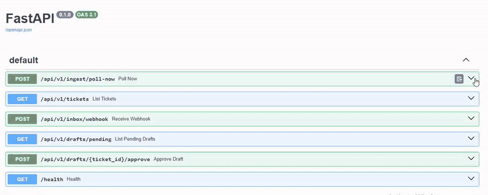

# OpsInboxAPI

An inbox that reads itself, figures out what each message needs, writes the first draft of a reply, and waits for a person to say go.

A FastAPI service that triages support tickets (webhook or a real Gmail inbox), classifies them, drafts a reply, and routes everything through a human approval step before anything gets sent. An LLM backend (Gemini) is available with automatic fallback to rule-based classification if it fails.



## Quickstart

```bash
git clone <repo-url> && cd ops-inbox-api
python -m venv venv && source venv/bin/activate
pip install -r requirements.txt
cp .env.example .env   # fill in real values
uvicorn app.main:app --reload
```


## API

All routes but `/health` need an `X-API-Key` header.

| Method | Endpoint | Purpose |
|---|---|---|
| GET | `/health` | liveness check |
| POST | `/api/v1/inbox/webhook` | submit a ticket (rate-limited, 5/min) |
| POST | `/api/v1/ingest/poll-now` | pull unread email from a real Gmail inbox |
| GET | `/api/v1/tickets` | debug: list everything stored |
| GET | `/api/v1/drafts/pending` | tickets waiting on a human, with their draft |
| POST | `/api/v1/drafts/{ticket_id}/approve` | send the draft, mark it sent |

```bash
curl -X POST http://127.0.0.1:8000/api/v1/inbox/webhook \
  -H "X-API-Key: devkey" -H "Content-Type: application/json" \
  -d '{"sender":"a@b.com","subject":"Site is down","body":"critical, ASAP"}'
```

## Flow

  webhook JSON **or** a real inbound email → validate → classify → extract entities → draft a reply → store → human reviews → approve → real email sent, *then* marked sent.

## Decisions worth knowing about

**Webhook responds in milliseconds, work happens after.** `BackgroundTasks` does the classifying/storing/drafting *after* the `202` goes out. Proved this matters with a real concurrency test — a blocking call left inside the route body freezes every other request, not just its own.

**Rules by default, LLM as upgrade.** Free, instant, zero external dependency to function at all. The LLM path is demonstrably better on messy real text, but it's a bonus, not a requirement — see the comparison below.

**Real inbox via IMAP polling, not Gmail Pub/Sub push.** Push notifications need a verified domain and a public HTTPS endpoint — real infra, not really a FastAPI lesson. Polling still means real auth against a live mail server and real MIME parsing (multipart, encoded headers, a deliberately malformed sender injected via IMAP `APPEND` to prove one bad email doesn't kill a batch).

**Background task failures are logged, not recovered.** Once the `202` ships there's no response left to carry a later failure back — it's caught and printed, and the ticket is lost. Production version: a retry queue, not a print statement.


## Known gaps

- Approve-and-send isn't fully atomic (see above)
- Lost background-task failures aren't recoverable, just logged
- No migration tooling
- Rate limit is per-IP, not per-API-key


## Tests

```bash
pytest -v
```
## Author

**Rabia L.** ([mxms-IP](https://github.com/mxms-IP))
